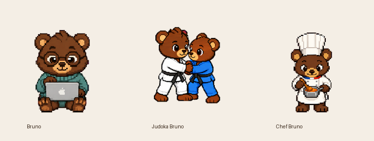

# Bruno 🐻

A custom animated pixel-art pet for **Codex**. Three dark brown bears to keep you company while you build: a cozy coder, a judoka practicing uchi-mata, and a French chef cooking soup.

When Codex is cooking, Bruno is too.



## Meet Bruno

| Bruno | Judoka Bruno | Chef Bruno |
| :---: | :---: | :---: |
|  |  |  |
| Glasses, a teal pullover, and his MacBook. | White judogi, black belt, and a blue-gi training partner. | Tall toque, tricolor collar, and a pot of soup. |

Every variant has **9 animation states**, **16 look directions**, and **73 frames** in a transparent v2 sprite sheet. The GIFs above loop continuously as artwork previews; installed playback is controlled by the app. See [known limitations](docs/known-issues.md).

## Install

Clone the repo and run the dependency-free Python installer:

```bash
git clone https://github.com/artush6/Bruno.git
cd Bruno
python3 scripts/install.py
```

This copies all three packages into `${CODEX_HOME:-$HOME/.codex}/pets/`. It does not change your selected pet. In the desktop app, open **Settings → Pets**, refresh the list, and select Bruno. If the list is stale, reopen the app.

To install just one:

```bash
python3 scripts/install.py bruno-judoka
```

See [How to use Bruno](docs/how-to-use.md) for manual installation, Windows instructions, selection, updates, and removal.

## Explore

- [Gallery](docs/gallery.md): all states, look directions, contact sheets, and videos.
- [How to use](docs/how-to-use.md): install and select your bear.
- [Sprite format](docs/sprite-format.md): layout, frame counts, and manifests.
- [Artwork and workflow](docs/artwork.md): design notes, sources, and editing.
- [Known limitations](docs/known-issues.md): playback and spacing behavior.
- [Changelog](CHANGELOG.md): current assets and previous revisions.

## Repository layout

```text
pets/       Ready-to-install packages: pet.json + spritesheet.png
docs/       Documentation, pictures, GIFs, and MP4 previews
scripts/    Local installer and package integrity checker
qa/         Current validation reports and package checksums
sources/    Prompts, generated strips, frames, QA, and historical revisions
archive/    Original non-pixel Bruno and its creative sources
```

Bruno is a community pet collection by [artush6](https://github.com/artush6), created with Codex and AI-generated artwork. It is an independent project. Codex and the pet runtime are provided by OpenAI.
