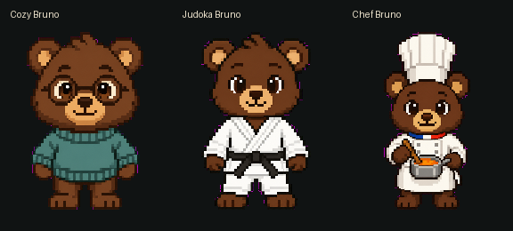

# Artwork and workflow

Bruno began as a dark brown bear, then became three pixel-art companions:

- **Bruno:** round glasses, a cozy teal pullover, and a MacBook for focused work.
- **Judoka Bruno:** white judogi and black belt, practicing an Ono-inspired partnered uchi-mata with a blue-gi bear. The movement is a playful stylization. [Uchi-mata technique reference](https://judo.ijf.org/techniques/Uchi-mata).
- **Chef Bruno:** classic French chef attire inspired by Paul Bocuse, with a tall toque and tricolor collar, stirring soup.

Artwork was generated with Codex's image generation tools. State strips were extracted, registered, assembled, cleaned for transparency, and reviewed through the Pets workflow. Packaging uses the installed hatch-pet manifest contract. The repository includes existing generated artwork; cloning or installing it does not call an image model.

## Sources

`sources/<variant>/` preserves the creative-workflow archive as regular files: prompts, canonical references, generated strips, extracted frames, intermediate atlases, semantic reviews, direction checks, and previews. Historical paths have been normalized to `<original-workspace>` and `<original-home>`.

`sources/<variant>/current-frames/` is the exact current atlas split into its 73 cells. For coder and chef, `padding-repair/` records the later uniform fit and validation. Top-level `pets/` is authoritative for installation; historical `final/` files inside sources may represent earlier revisions. Generation job manifests record their original workflow state and are provenance, not an executable build pipeline.

The original non-pixel bear is preserved in `archive/original-bruno/` as design history. The current installer installs the three pixel variants only.

## Editing

Start from a canonical reference and preserve the bear's face, palette, proportions, outlines, and clothing. Keep one shared scale and baseline across animation states. Preserve the jump's vertical lift and enough width for the partnered throw.

When replacing art, use the full v2 grid and review every state plus the complete clockwise look loop. Re-render previews from the final encoded sheet, run the Pets production validators, then update package checksums after approving the change. The included checksum checker detects accidental changes but does not judge animation quality.

The preserved generation helpers are historical workflow scripts with environment-specific dependencies. The `scripts/` folder at the repository root contains the supported standalone packaging utilities.

## Credits

Concept and direction: [artush6](https://github.com/artush6). Artwork created with Codex and AI image generation. OpenAI provides Codex and the pet runtime. This community asset collection is independent of OpenAI. Product names and marks depicted in the artwork belong to their respective owners.
