# Bruno gallery

Previews below are rendered from the current packaged sprite sheets. GIFs demonstrate the artwork independently of app state switching.

## Bruno

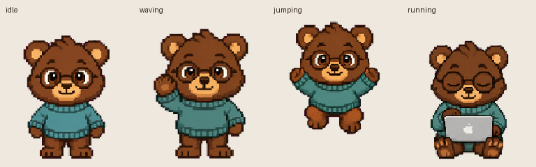

| Idle | Working | Waiting | Review |
| :---: | :---: | :---: | :---: |
| 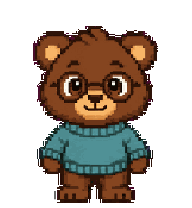 |  | 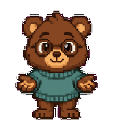 |  |

[All-state GIF](images/bruno/all-states.gif) · [MP4](images/bruno/all-states.mp4) · [Jump and landing](images/bruno/idle-jump-idle.gif) · [Look loop](images/bruno/look-loop.gif)

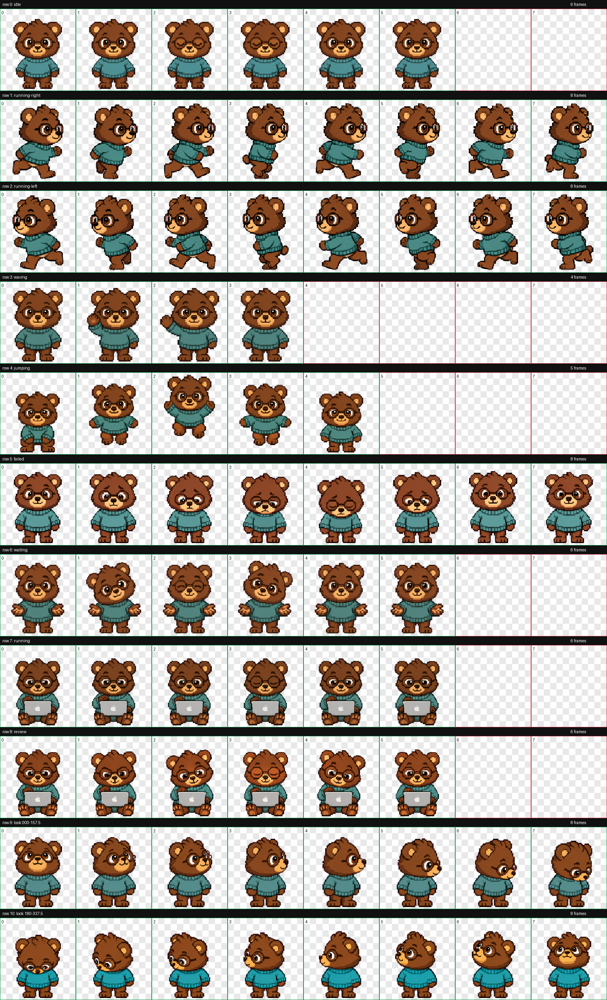

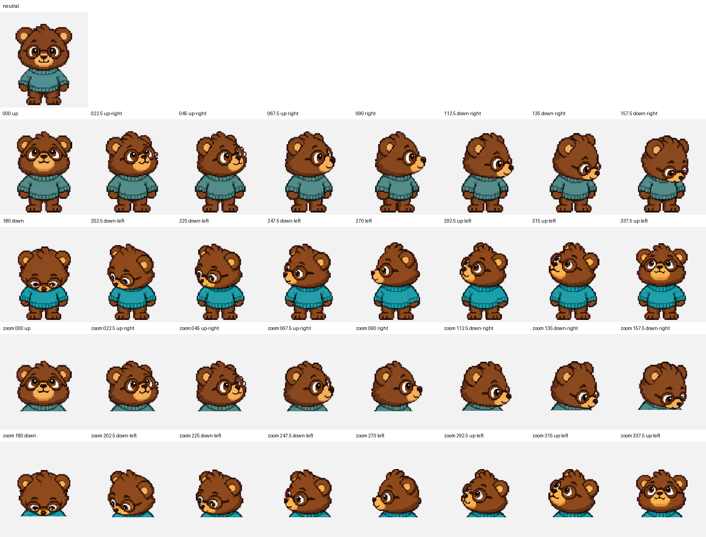

## Judoka Bruno

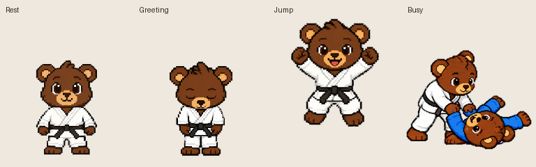

| Idle | Working | Waiting | Review |
| :---: | :---: | :---: | :---: |
| 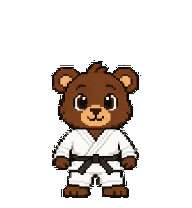 | 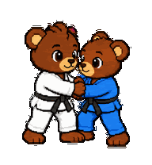 | 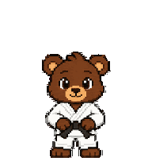 | 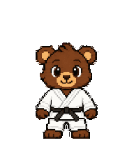 |

[All-state GIF](images/bruno-judoka/all-states.gif) · [MP4](images/bruno-judoka/all-states.mp4) · [Jump and landing](images/bruno-judoka/idle-jump-idle.gif) · [Look loop](images/bruno-judoka/look-loop.gif)

[Medium-paced throw](images/bruno-judoka/partnered-throw-medium.gif) · [Slower throw](images/bruno-judoka/partnered-throw-slow.gif). These are timing comparisons; they do not set installed playback speed.

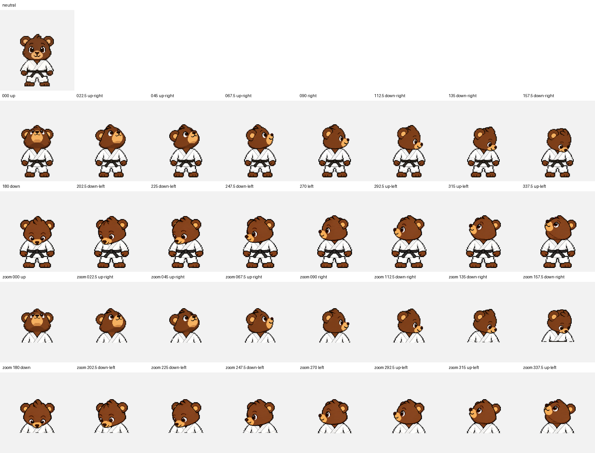

## Chef Bruno

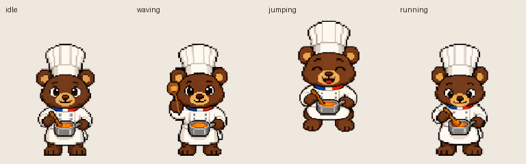

| Idle | Working | Waiting | Review |
| :---: | :---: | :---: | :---: |
| 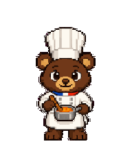 |  | 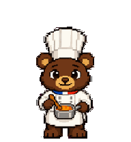 | 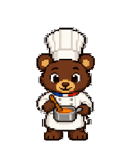 |

[All-state GIF](images/bruno-chef/all-states.gif) · [MP4](images/bruno-chef/all-states.mp4) · [Jump and landing](images/bruno-chef/idle-jump-idle.gif) · [Look loop](images/bruno-chef/look-loop.gif)

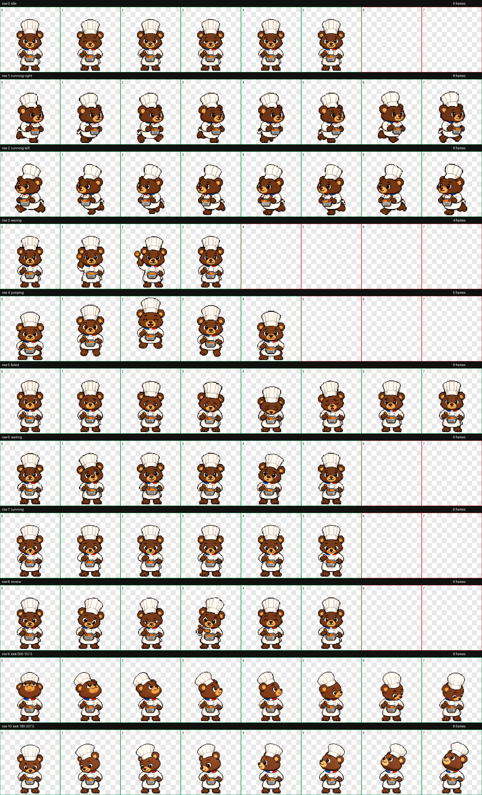

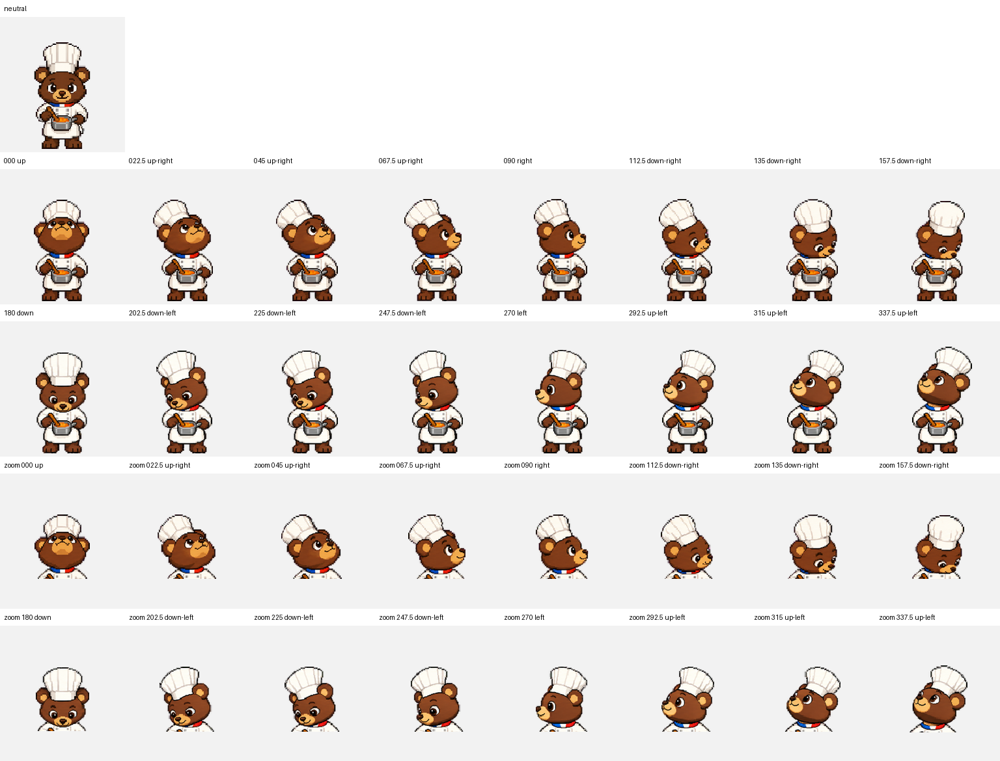

## Padding improvements

The current coder and chef packages use one consistent scale adjustment across every state to reduce overhead padding while preserving jumps and landing alignment.

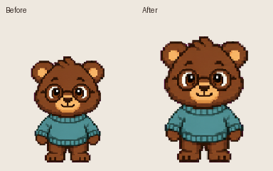

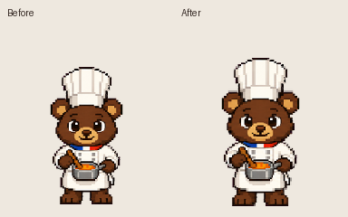

## More animations

Each variant's image folder also contains `running-right.gif`, `running-left.gif`, `waving.gif`, `jumping.gif`, and `failed.gif`. See [the format guide](sprite-format.md) for their meaning.
