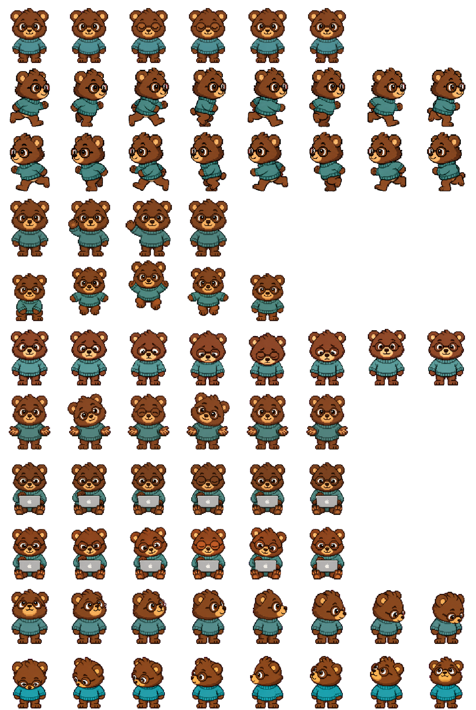

# Sprite format

The packages follow the installed Codex hatch-pet v2 contract: PNG with transparency, 1536×2288 pixels, eight columns and eleven rows. Each cell is 192×208 pixels. All required frames begin at the left of their row; unused cells are transparent.

| Row (zero-based) | State | Frames | Purpose |
| --- | --- | --- | --- |
| 0 | idle | 6 | Calm breathing and blinking |
| 1 | running-right | 8 | Movement toward screen-right |
| 2 | running-left | 8 | Movement toward screen-left |
| 3 | waving | 4 | Greeting |
| 4 | jumping | 5 | Lift and return to ground |
| 5 | failed | 8 | Failure reaction |
| 6 | waiting | 6 | Approval or input needed |
| 7 | running | 6 | Active task work: typing, throwing, or cooking |
| 8 | review | 6 | Checking completed work |
| 9 | look directions | 8 | 000° through 157.5° |
| 10 | look directions | 8 | 180° through 337.5° |

The atlas contains 73 populated cells and 15 empty cells. Direction order is clockwise in 22.5° increments. 000° means up, 090° screen-right, 180° down, and 270° screen-left. The resting front pose comes from idle.

## Manifest

```json
{
  "id": "bruno",
  "displayName": "Bruno",
  "description": "A cozy pixel bear with glasses and a teal pullover, typing on his MacBook while you work.",
  "spriteVersionNumber": 2,
  "spritesheetPath": "spritesheet.png"
}
```

These local IDs belong to the package. Account-specific uploaded pet IDs are separate and are not needed to install it.



## Playback

The sheet contains artwork and ordering; the host runtime owns frame duration, state transitions, repetition, cursor gaze, and reduced-motion behavior. GIF/MP4 timing is preview metadata, not an installed-pet setting.

The work preview uses 120 ms for the first five frames and 220 ms for recovery, totaling 820 ms. The separate medium-paced Judoka preview doubles those values to 1640 ms. See [known issues](known-issues.md) for the inspected app's fallback behavior.

## Validation

The artwork passed the Pets pipeline's structural and visual checks before publication. Current reports are in `qa/`, with historical source reports under `sources/`. The repository integrity checker is a lightweight packaging check; it does not replace visual review or the full production validators.
